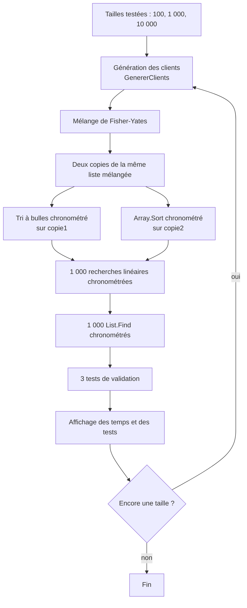
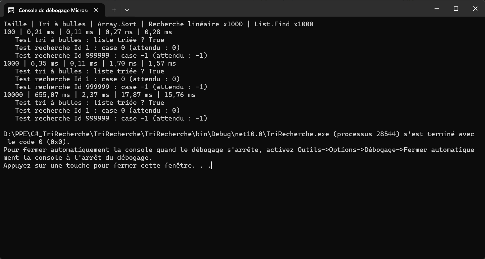
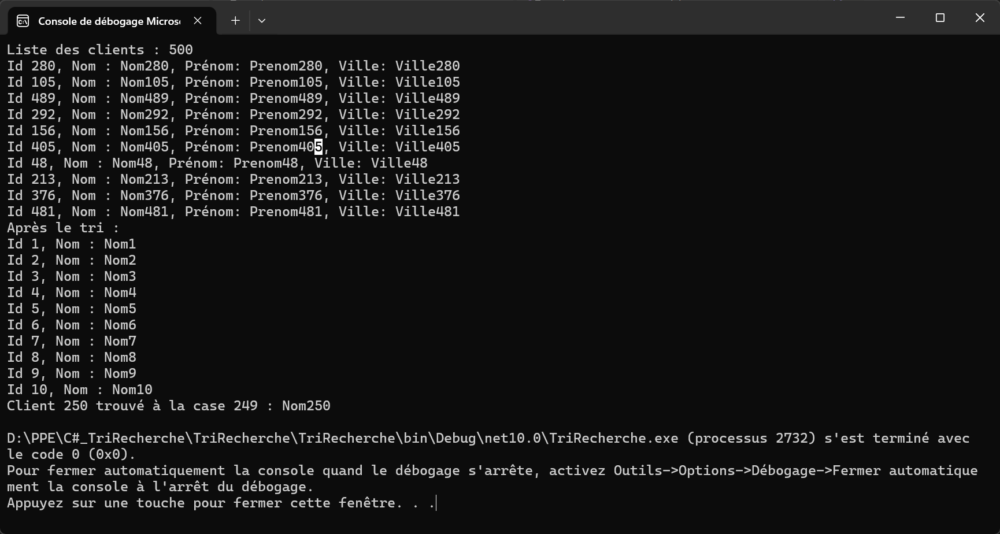
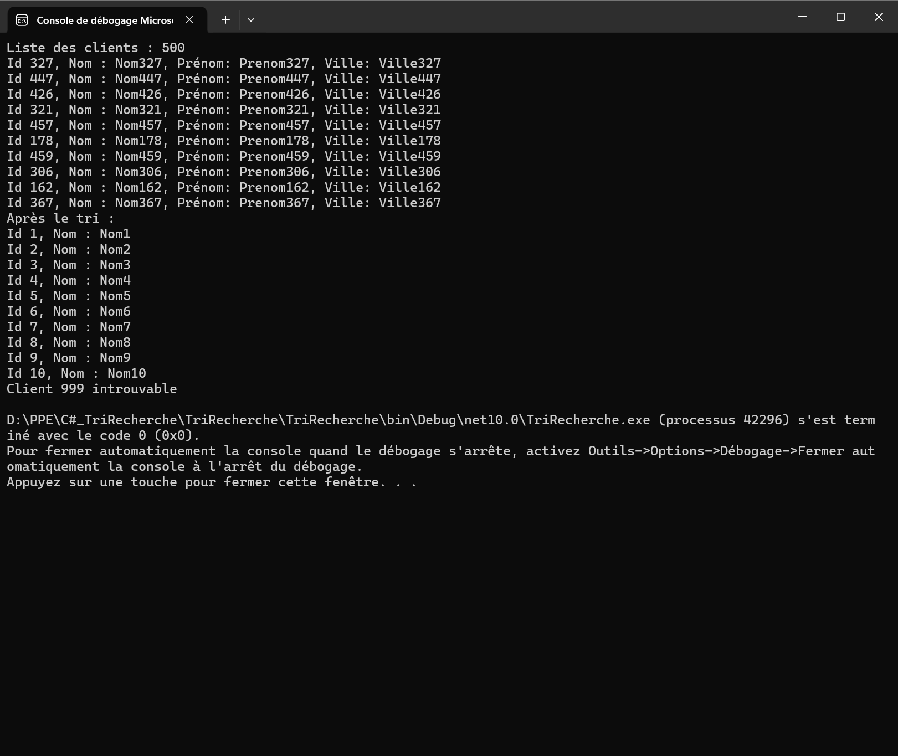
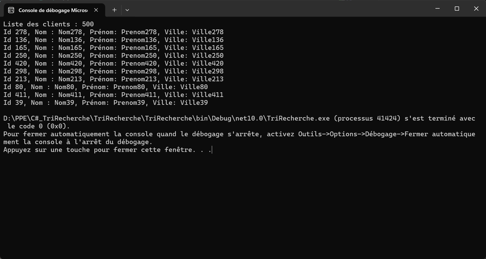
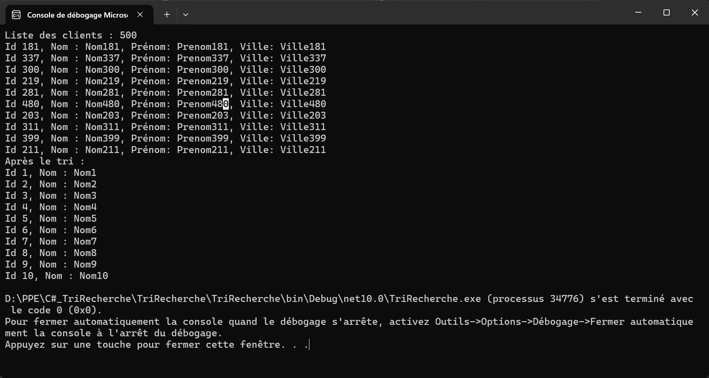

# 🔎 Tri et recherche de clients en C#


> **En une phrase :** j'ai écrit à la main un **tri à bulles** et une **recherche linéaire** sur une liste de clients, puis j'ai mesuré leurs temps face aux méthodes natives de .NET : à 10 000 clients, `Array.Sort` est environ **275 fois plus rapide** que mon tri.

Application console C# qui génère une liste de clients, la trie et y recherche un client avec mes propres algorithmes, puis compare leurs temps d'exécution avec les méthodes natives de .NET.
👉 Le tableau des mesures est dans [Résultats](#-résultats), l'explication dans [Analyse de complexité](#-analyse-de-complexité).

> [!NOTE]
> Projet scolaire : **PPE (projet pratique encadré), Projet 2** du cours **« Algorithmique orientée C# (319) »**, 1re année, classe E1B, Geneva Institute of Technology (GIT), octobre 2026.

---

## 🗂️ Sommaire

- [Contexte et objectif](#-contexte-et-objectif)
- [Fonctionnalités](#-fonctionnalités)
- [Structure du dépôt](#-structure-du-dépôt)
- [Prérequis](#-prérequis)
- [Installation et exécution](#-installation-et-exécution)
- [Fonctionnement](#-fonctionnement)
  - [Données](#données)
  - [Tri à bulles](#tri-à-bulles)
  - [Recherche linéaire](#recherche-linéaire)
  - [Mesure des performances](#mesure-des-performances)
- [Résultats](#-résultats)
- [Analyse de complexité](#-analyse-de-complexité)
- [Tests et validation](#-tests-et-validation)
- [Captures d'écran](#-captures-décran)
- [Problèmes rencontrés et solutions](#-problèmes-rencontrés-et-solutions)
- [Ce que j'ai appris](#-ce-que-jai-appris)
- [Historique du projet](#-historique-du-projet)
- [Méthode de travail](#-méthode-de-travail)
- [Pistes d'amélioration](#-pistes-damélioration)
- [Sources](#-sources)

---

## 🎯 Contexte et objectif

### L'énoncé

Une entreprise veut **trier** et **rechercher** efficacement dans une liste de plusieurs centaines de clients. Le travail demandé est le suivant :

1. générer ou importer un jeu de données clients ;
2. implémenter un **tri manuel** (sans méthode native) ;
3. implémenter une **recherche manuelle** (linéaire ou dichotomique) ;
4. comparer les temps d'exécution avec les méthodes natives `Array.Sort` et `List.Find` ;
5. documenter le travail.

**Livrables attendus :** le code source, un tableau comparatif des performances et une note explicative sur les complexités observées.

### Exigences de l'énoncé → où c'est fait

| Exigence de l'énoncé | Où c'est fait | Statut |
|---|---|:---:|
| Générer un jeu de données clients | `GenererClients()` dans [`Program.cs`](TriRecherche/Program.cs) — voir [Données](#données) | ✅ |
| Tri manuel, sans méthode native | `TriABulles()` — voir [Tri à bulles](#tri-à-bulles) | ✅ |
| Recherche manuelle (linéaire ou dichotomique) | `RechercheLineaire()` — voir [Recherche linéaire](#recherche-linéaire) | ✅ |
| Comparer avec `Array.Sort` / `List.Find` | Mesures avec `Stopwatch` — voir [Mesure des performances](#mesure-des-performances) | ✅ |
| Documenter | Ce README | ✅ |
| Livrable : code source | [`TriRecherche/Program.cs`](TriRecherche/Program.cs) | ✅ |
| Livrable : tableau comparatif des performances | [Résultats](#-résultats) | ✅ |
| Livrable : note explicative sur les complexités | [Analyse de complexité](#-analyse-de-complexité) | ✅ |

### Critères d'évaluation

| Critère | Poids | Où le trouver dans ce dépôt |
|---|:---:|---|
| Réalisation technique | 30 % | [`Program.cs`](TriRecherche/Program.cs), [Fonctionnement](#-fonctionnement) |
| Respect des consignes | 25 % | Tableau des exigences ci-dessus |
| Tests / validation | 25 % | [Tests et validation](#-tests-et-validation) |
| Documentation | 20 % | Ce README, [Analyse de complexité](#-analyse-de-complexité) |

---

## ✨ Fonctionnalités

- **Génération automatique** de clients (`Id`, `Nom`, `Prenom`, `Ville`), sans aucune saisie au clavier.
- **Mélange aléatoire** de la liste avec l'algorithme de Fisher-Yates.
- **Tri à bulles** par `Id`, écrit à la main (sans méthode native).
- **Recherche linéaire** par `Id`, écrite à la main : elle renvoie le numéro de la case, ou `-1` si le client est introuvable.
- **Comparaison des temps d'exécution** avec `Array.Sort` et `List.Find`, mesurés avec `Stopwatch`, pour 100, 1 000 et 10 000 clients.
- **Tests automatiques** : vérification que la liste est bien triée (`EstTrie`), recherche d'un `Id` présent et d'un `Id` absent.
- **Affichage** d'un tableau de résultats dans la console.

---

## 📁 Structure du dépôt

```text
ppe-319-projet2-tri-recherche/
├── TriRecherche/                (projet console C#)
│   ├── Program.cs               (génération, tri, recherche, mesures, tests)
│   └── TriRecherche.csproj
├── docs/captures/               (5 captures d'écran)
├── TriRecherche.slnx            (solution Visual Studio)
├── .gitignore
└── README.md
```

Tout le code se trouve dans un seul fichier, `Program.cs` :

- en haut, le **programme principal** écrit en *top-level statements* (instructions de premier niveau, sans méthode `Main`) ;
- ensuite, les **fonctions locales statiques** : `GenererClients`, `Afficher10`, `TriABulles`, `RechercheLineaire`, `EstTrie` (`Afficher10` affichait les 10 premiers clients pendant les premières étapes ; elle n'est plus appelée) ;
- tout en bas, la **classe `Client`**.

---

## 🧰 Prérequis

- [SDK .NET 10](https://dotnet.microsoft.com/download)
- [Visual Studio 2026](https://visualstudio.microsoft.com/) (facultatif : la ligne de commande `dotnet` suffit)
- [Git](https://git-scm.com/) pour cloner le dépôt

---

## ▶️ Installation et exécution

### En ligne de commande

```bash
git clone https://github.com/L4ami/ppe-319-projet2-tri-recherche.git
cd ppe-319-projet2-tri-recherche
dotnet run --project TriRecherche
```

Pour des mesures plus justes, lancer le programme en mode **Release** (code optimisé par le compilateur) :

```bash
dotnet run -c Release --project TriRecherche
```

### Avec Visual Studio 2026

1. Ouvrir la solution `TriRecherche.slnx` (à la racine du dépôt) dans Visual Studio 2026.
2. Appuyer sur **F5** pour compiler et lancer le programme.

> [!TIP]
> Les mesures présentées plus bas ont été faites en mode **Debug**. En mode **Release**, les temps seront différents (en général plus courts).

---

## 🏗️ Fonctionnement

Le programme répète les mêmes étapes pour trois tailles de liste : 100, 1 000 et 10 000 clients.



### Données

#### La classe `Client`

Un client possède quatre **propriétés** : un numéro `Id`, un `Nom`, un `Prenom` et une `Ville`. Le **constructeur** permet de créer un client en donnant ces quatre valeurs d'un seul coup.

```csharp
public class Client
{
    public Client(int id, string nom, string prenom, string ville)
    { Id = id; Nom = nom; Prenom = prenom; Ville = ville; }
    public int Id { get; set; }
    public string Nom { get; set; }
    public string Prenom { get; set; }
    public string Ville { get; set; }
}
```

#### Génération des clients

`GenererClients(nombre)` crée automatiquement `nombre` clients avec une boucle `for`. Le compteur `i` sert d'`Id` et permet de fabriquer des valeurs uniques : `Nom1`, `Prenom1`, `Ville1`, puis `Nom2`, etc.

#### Mélange de Fisher-Yates

Après la boucle, les clients sont rangés dans l'ordre (Id 1, 2, 3…). Or **trier une liste déjà triée ne prouve rien**. Il faut donc d'abord la mélanger.

Le mélange de Fisher-Yates ressemble à un tirage de cartes au hasard dans un paquet :

1. on part de la **dernière case** de la liste ;
2. on choisit une case au hasard entre la première et la case actuelle (`hasard.Next(i + 1)` donne un nombre entre `0` et `i`) ;
3. on **échange** les deux clients ;
4. on recule d'une case et on recommence, jusqu'au début de la liste.

Ainsi, chaque client a la même chance de finir à n'importe quelle place.

```csharp
static List<Client> GenererClients(int nombre)
{
    List<Client> liste = new List<Client>();
    for (int i = 1; i <= nombre; i++)
    {
        liste.Add(new Client(i, $"Nom{i}", $"Prenom{i}", $"Ville{i}"));
    }
    Random hasard = new Random();
    for (int i = liste.Count - 1; i > 0; i--)
    {
        int j = hasard.Next(i + 1);
        Client temp = liste[i];
        liste[i] = liste[j];
        liste[j] = temp;
    }
    return liste;
}
```

### Tri à bulles

#### Principe

On parcourt la liste en comparant chaque client avec son **voisin de droite**. S'ils sont dans le mauvais ordre (le plus grand `Id` à gauche), on les **échange**. À la fin d'une passe, le plus grand `Id` est « remonté » tout au bout de la liste, comme une bulle qui monte à la surface. On recommence jusqu'à ce que toute la liste soit triée.

#### Exemple à la main sur `[5, 2, 8, 1]`

| Passe | Comparaisons | Échanges | Liste après la passe |
|:---:|---|---|---|
| 1 | 5 / 2, 5 / 8, 8 / 1 | 5 ↔ 2, puis 8 ↔ 1 (5 / 8 déjà dans l'ordre) | `[2, 5, 1, 8]` |
| 2 | 2 / 5, 5 / 1 | 5 ↔ 1 (2 / 5 déjà dans l'ordre) | `[2, 1, 5, 8]` |
| 3 | 2 / 1 | 2 ↔ 1 | `[1, 2, 5, 8]` |

> [!TIP]
> **Optimisation que j'ai trouvée moi-même sur papier :** après chaque passe, la fin de la liste est déjà triée, donc il est inutile de la comparer à nouveau. Sur l'exemple, cela fait **3 + 2 + 1 = 6 comparaisons au lieu de 4 passes × 3 = 12**. Dans le code, c'est le `- passe` de la boucle intérieure. La complexité reste O(n²) (environ n²/2 comparaisons), mais le tri fait environ deux fois moins de travail.

#### Code

```csharp
static void TriABulles(List<Client> liste)
{
    // Une passe de moins que le nombre de clients suffit
    for (int passe = 0; passe < liste.Count - 1; passe++)
    {
        // "- passe" : la fin de la liste est déjà triée, inutile d'y revenir
        for (int i = 0; i < liste.Count - 1 - passe; i++)
        {
            // Le client de gauche a un Id plus grand que son voisin de droite ?
            if (liste[i].Id > liste[i + 1].Id)
            {
                // Alors on les échange grâce à la variable temporaire
                Client temp = liste[i];
                liste[i] = liste[i + 1];
                liste[i + 1] = temp;
            }
        }
    }
}
```

#### L'échange avec `temp`

Pour échanger le contenu de deux verres, il faut un **troisième verre** vide. Sans lui, en versant le premier verre dans le second, on perd le contenu du second. La variable `temp` joue le rôle de ce 3e verre :

1. `Client temp = liste[i];` : je mets le client de gauche de côté ;
2. `liste[i] = liste[i + 1];` : le client de droite prend la place de gauche ;
3. `liste[i + 1] = temp;` : le client mis de côté va à droite.

### Recherche linéaire

#### Principe

On regarde les cases **une par une**, de la première (`liste[0]`) à la dernière (`liste[Count - 1]`). Dès que l'`Id` correspond, on renvoie le numéro de la case avec `return i`. Si on arrive au bout sans l'avoir trouvé, on renvoie `-1` : ce n'est jamais un numéro de case valide, donc cela veut dire « introuvable ». Cette recherche fonctionne sur une liste triée comme sur une liste mélangée.

```csharp
static int RechercheLineaire(List<Client> liste, int idCherche)
{
    for (int i = 0; i < liste.Count; i++)
    {
        if (liste[i].Id == idCherche) { return i; }
    }
    return -1;
}
```

### Mesure des performances

Pour comparer mes algorithmes aux méthodes natives de façon **équitable**, j'ai suivi cette méthode :

- **Trois tailles** de liste : 100, 1 000 et 10 000 clients. Pour chaque taille, une nouvelle liste mélangée est générée.
- **Une copie par méthode de tri**, faite à partir de la même liste mélangée :
  - `copie1 = new List<Client>(clients)` pour le tri à bulles ;
  - `copie2 = clients.ToArray()` pour `Array.Sort(copie2, (a, b) => a.Id.CompareTo(b.Id))`. La partie `(a, b) => a.Id.CompareTo(b.Id)` indique à `Array.Sort` de comparer les clients selon leur `Id`.

  Sans ces copies, le deuxième tri recevrait une liste déjà triée par le premier, et la comparaison serait faussée.
- **1 000 recherches** sur des `Id` tirés au hasard, pour ma recherche linéaire puis pour `clients.Find(c => c.Id == id)`. Une seule recherche est trop rapide pour être mesurée correctement.
- **Chronométrage** avec `Stopwatch` (espace de noms `System.Diagnostics`), en millisecondes.
- Programme lancé en mode **Debug**, une seule exécution.

---

## ✅ Résultats

Temps mesurés en **millisecondes** (mode Debug, une exécution) :

| Taille | Tri à bulles | `Array.Sort` | Recherche linéaire ×1000 | `List.Find` ×1000 |
|---:|---:|---:|---:|---:|
| 100 | 0,21 | 0,11 | 0,27 | 0,28 |
| 1 000 | 6,35 | 0,11 | 1,70 | 1,57 |
| 10 000 | 655,07 | 2,37 | 17,87 | 15,76 |

Ce que je retiens :

- À **10 000 clients**, `Array.Sort` est environ **275 fois plus rapide** que mon tri à bulles (2,37 ms contre 655,07 ms).
- Ma recherche linéaire et `List.Find` ont des temps **presque identiques**, car elles fonctionnent sur le même principe.



*Capture 05 : tableau des temps mesurés et résultats des tests.*

---

## 📈 Analyse de complexité

La notation **Big-O** (« grand O ») indique comment le temps d'un algorithme augmente quand la taille des données augmente.

### Rapports mesurés et rapports théoriques

Entre 1 000 et 10 000 clients, la liste est **10 fois plus grande**. Voici de combien le temps a été multiplié :

| Méthode | Complexité | 1 000 clients | 10 000 clients | Rapport mesuré | Rapport théorique |
|---|:---:|---:|---:|:---:|:---:|
| Tri à bulles | O(n²) | 6,35 ms | 655,07 ms | ×103 | ×100 |
| `Array.Sort` | O(n log n) | 0,11 ms | 2,37 ms | ×21 | ≈ ×13 |
| Recherche linéaire ×1000 | O(n) | 1,70 ms | 17,87 ms | ×10,5 | ×10 |
| `List.Find` ×1000 | O(n) | 1,57 ms | 15,76 ms | ×10 | ×10 |

### Tri à bulles : O(n²)

Le tri à bulles est une **boucle dans une boucle**. Quand la liste est 10 fois plus longue, il y a 10 fois plus de passes, et chaque passe est 10 fois plus longue : 10 × 10 = **×100**. J'ai mesuré **×103**, ce qui correspond très bien à la théorie.

### Recherche linéaire et `List.Find` : O(n)

La recherche linéaire est **une seule boucle** qui regarde les clients un par un. Avec 10 fois plus de clients, il y a en moyenne 10 fois plus de cases à regarder : **×10**. J'ai mesuré ×10,5.

`List.Find` parcourt elle aussi la liste du début jusqu'au client cherché. C'est le **même principe** que ma recherche linéaire, donc la même complexité O(n) : c'est pour cela que les deux colonnes ont presque les mêmes temps (×10 mesuré).

### `Array.Sort` : O(n log n)

`Array.Sort` utilise un algorithme de tri beaucoup plus efficace que le tri à bulles. En théorie, passer de 1 000 à 10 000 éléments multiplie le temps par environ **×13**. J'ai mesuré ×21, mais le temps à 1 000 clients (0,11 ms) est inférieur à 1 ms, donc trop petit pour être précis : on voit d'ailleurs le même temps (0,11 ms) pour 100 et pour 1 000 clients. Ce rapport n'est donc pas fiable.

### Conclusion

Les rapports mesurés confirment la théorie : le tri à bulles (O(n²)) devient très lent quand la liste grandit, alors que `Array.Sort` (O(n log n)) reste rapide. Pour quelques centaines de clients, la différence est faible, mais à 10 000 clients elle est énorme (environ 275 fois).

> [!WARNING]
> **Limites des mesures**
> - Les temps **inférieurs à 1 ms** sont imprécis : un petit écart change beaucoup le rapport.
> - Les temps **varient d'une exécution à l'autre** (l'ordinateur fait d'autres choses en même temps). Ici, chaque mesure n'a été faite qu'**une seule fois**.
> - Le mode **Debug** est plus lent que le mode **Release**, car le code n'est pas optimisé.

---

## 🧪 Tests et validation

Tous les tests sont **réussis**.

| Test | Attendu | Obtenu |
|---|---|---|
| `EstTrie` après le tri à bulles, liste de 100 clients | `True` | `True` ✅ |
| `EstTrie` après le tri à bulles, liste de 1 000 clients | `True` | `True` ✅ |
| `EstTrie` après le tri à bulles, liste de 10 000 clients | `True` | `True` ✅ |
| Recherche de l'Id 1 dans la liste triée | case 0 | case 0 ✅ |
| Recherche de l'Id 999999 (n'existe pas) | `-1` | `-1` ✅ |
| Recherche de l'Id 250 dans une liste de 500 clients | case 249 | case 249 ✅ |
| Recherche de l'Id 999 dans une liste de 500 clients | introuvable | introuvable ✅ |

La fonction `EstTrie` vérifie automatiquement le résultat du tri : elle compare chaque client avec son voisin de droite. Si un seul couple est dans le mauvais ordre, elle renvoie `false` ; sinon, elle renvoie `true`.

```csharp
static bool EstTrie(List<Client> liste)
{
    for (int i = 0; i < liste.Count - 1; i++)
    {
        if (liste[i].Id > liste[i + 1].Id) { return false; }
    }
    return true;
}
```



*Capture 03 : l'Id 250 est trouvé à la case 249 (la première case porte le numéro 0).*



*Capture 04 : l'Id 999 n'existe pas dans une liste de 500 clients, il est donc introuvable.*

---

## 🖼️ Captures d'écran



*Capture 01 : 500 clients générés, affichage des 10 premiers après le mélange.*



*Capture 02 : 500 clients triés par Id ; les 10 premiers avant le tri (mélangés), puis après le tri (Id 1 à 10).*

Les autres captures se trouvent dans les sections correspondantes :

- [Capture 03 : recherche trouvée](docs/captures/03-recherche-trouve.png) — voir [Tests et validation](#-tests-et-validation)
- [Capture 04 : recherche introuvable](docs/captures/04-recherche-introuvable.png) — voir [Tests et validation](#-tests-et-validation)
- [Capture 05 : mesures et tests](docs/captures/05-mesures-et-tests.png) — voir [Résultats](#-résultats)

---

## ⚠️ Problèmes rencontrés et solutions

| # | Problème | Cause | Solution |
|:---:|---|---|---|
| 1 | Classe `Client` avec 14 erreurs (`Public` avec une majuscule, accolades mal placées) | C# est sensible à la casse, et chaque bloc doit être bien fermé | Réécriture propre de la classe : 0 erreur |
| 2 | `new Client(...)` seul, puis `client.Nom` : erreur CS0103 (« le nom 'client' n'existe pas ») | L'objet n'était rangé dans aucune variable | `Client client = new Client(...)` |
| 3 | `string nom = new Client(...)` : erreur CS0029 | Type de variable incompatible | Le type de la variable doit correspondre à l'objet : `Client` |
| 4 | Deux variables nommées `client` : erreur CS0128 | Le même nom de variable était déclaré deux fois | Des noms uniques (`client2`) |
| 5 | Compteur écrit à la main (`"Liste des clients :2"`) | La valeur était figée et ne suivait pas la liste | Interpolation : `$"... {clients.Count}"` |
| 6 | Code proposé par l'autocomplétion avec `Console.ReadLine()` | Il aurait demandé 1 500 saisies au clavier | Génération automatique avec le compteur `i`. **Leçon :** relire et comprendre tout code proposé avant de l'accepter |
| 7 | Bloc parasite ajouté par l'autocomplétion | La variable `i` était utilisée en dehors de sa boucle | Bloc supprimé |
| 8 | Liste générée déjà triée | Un tri sur une liste déjà triée ne prouve rien | Mélange de Fisher-Yates |
| 9 | Échange sans variable temporaire | Un élément était écrasé et perdu | Variable `temp` (image du 3e verre) |
| 10 | Confusion sur les indices de la liste | Les indices commencent à 0 | La première case est `liste[0]`, la dernière `liste[Count - 1]` |
| 11 | Une seule recherche est trop rapide pour être mesurée | Le temps obtenu est trop petit pour être fiable | Chronométrer 1 000 recherches |
| 12 | Comparaison injuste entre les deux tris | Le 2e tri aurait reçu une liste déjà triée | Chaque méthode travaille sur une copie de la même liste mélangée |

---

## 🧠 Ce que j'ai appris

- **Classe, constructeur et propriétés** : décrire un client et le créer avec `new`.
- **Variables et types** : `int`, `string`, `bool`, `Client`, et pourquoi le type doit correspondre à la valeur.
- **Listes et indices** : `List<Client>`, `Add`, `Count`, première case `[0]`, dernière case `[Count - 1]`.
- **Boucles `for` et `foreach`** : répéter une action, parcourir une liste.
- **Conditions `if` / `else`** : comparer deux clients.
- **Fonctions et `return`** : découper le programme en morceaux réutilisables qui renvoient un résultat.
- **Échange avec `temp`** : échanger deux valeurs sans en perdre une.
- **Complexité Big-O** : O(n), O(n log n), O(n²), et comment la vérifier par des mesures.
- **Mesure avec `Stopwatch`** : chronométrer un morceau de code de façon équitable.
- **Git** : versionner mon projet et le publier sur GitHub.

---

## 🗓️ Historique du projet

| Date (octobre 2026) | Étape |
|---|---|
| 07/10 | Algorithmes sur papier : tri à bulles, recherche dichotomique, comparaison du nombre de coups |
| 09/10 | Classe `Client` |
| 12–13/10 | Variables, premier client, listes |
| 14/10 | Boucles `foreach` et `for` |
| 15/10 | Génération de 500 clients et mélange, tri à bulles, recherche linéaire, fonctions, mesures avec `Stopwatch`, tests |

---

## 🤝 Méthode de travail

> [!NOTE]
> J'ai réalisé ce projet avec l'aide de **Claude** (assistant IA d'Anthropic), utilisé comme **tuteur** : il m'a expliqué les notions, a corrigé mes erreurs et m'a fourni certains morceaux de code. Ces morceaux de code, je les ai tapés moi-même, puis exécutés, testés et commentés. Les calculs de rapports (×100, ×8) et l'optimisation `- passe` du tri à bulles viennent de moi.

---

## 🚀 Pistes d'amélioration

- Ajouter une **recherche dichotomique**, en O(log n), sur la liste triée.
- Faire les mesures en mode **Release**.
- **Répéter chaque mesure** plusieurs fois et garder la moyenne.
- Essayer **d'autres tris** (tri par insertion, tri rapide) et les comparer.
- Générer des **noms et des villes réalistes**.

---

## 📚 Sources

- Microsoft Learn — [Collections en C#](https://learn.microsoft.com/fr-fr/dotnet/standard/collections/)
- Microsoft Learn — [`Array.Sort`](https://learn.microsoft.com/fr-fr/dotnet/api/system.array.sort)
- Microsoft Learn — [`List<T>.Find`](https://learn.microsoft.com/fr-fr/dotnet/api/system.collections.generic.list-1.find)
- Microsoft Learn — [`Stopwatch`](https://learn.microsoft.com/fr-fr/dotnet/api/system.diagnostics.stopwatch)

---

**Auteur :** Paul Giocanti ([@L4ami](https://github.com/L4ami)) · Octobre 2026<br>
CFC d'informaticien + Bachelor (double certification) · Geneva Institute of Technology
